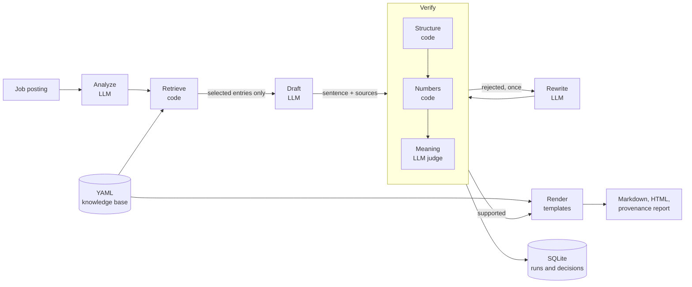

# attesto

[](https://github.com/maku85/attesto/actions/workflows/ci.yml)

A career knowledge base exposed via MCP, with claim-level provenance. _No source, no claim._

attesto keeps a professional history as YAML files and writes CVs and cover letters from it, tailored to a
job posting, in Italian, English and German, with Swiss conventions.

> **Status: 0.9.** The pipeline is complete, but its error rates are
> [not measured yet](#evaluation).

## The problem

Ask an LLM to tailor a CV and it improves the facts as well as the wording. "Contributed to" becomes "led",
a number appears from nowhere, a skill from the posting turns up in the profile. Each change is small and
plausible, and the person whose name is on the document answers for it.

## No source, no claim

In attesto every sentence about the candidate is an object that names the entries it was derived from. It
reaches the document only if it passes three checks:

| Check         | Done by           | Example it rejects                                                                                     |
| ------------- | ----------------- | ------------------------------------------------------------------------------------------------------ |
| **Structure** | code              | an achievement of one employer under another; a second sentence hiding behind the sources of the first |
| **Numbers**   | code              | "from 45 to 4 minutes" when the source says 8; "sechs Jahre" of a skill used for two                   |
| **Meaning**   | a second LLM call | "Led the development of…" when the source says "Contributed to…"                                       |

A rejected sentence gets one rewrite, goes through all checks again, and is then dropped. Names, dates,
degrees and contacts are not written by the LLM at all: templates copy them.

What this guarantees, and what it does not:

- Code **blocks** unknown sources, sources from the wrong employer, and any number it can read that no cited
  source states.
- The judge **reduces** invented meaning. It can be wrong, so its errors are measured, in both directions.
- Nothing checks the knowledge base itself. If it says too much, so will the CV. The first generated
  documents showed two such defects in the way entries were presented as sources; they are described in
  [ADR 0001](docs/adr/0001-yaml-as-source-of-truth.md).

## How it works



The judge sees one sentence and the entries it cites. It never sees the posting, so a posting cannot
influence it. Source IDs are enums in the output schema of each request and are checked again by code.

Design decisions are recorded in [docs/adr](docs/adr):
[YAML as source of truth](docs/adr/0001-yaml-as-source-of-truth.md),
[SQLite for runs](docs/adr/0002-sqlite-for-runs.md),
[deterministic retrieval](docs/adr/0003-deterministic-retrieval.md),
[claim-level provenance](docs/adr/0004-claim-level-provenance.md),
[verifier strategy](docs/adr/0005-verifier-strategy.md),
[rendering](docs/adr/0006-rendering.md),
[evaluation](docs/adr/0007-evaluation.md),
[PDF](docs/adr/0008-pdf.md).

## Quickstart

Needs Node.js 22.18 or later and pnpm. The sample person in `examples/kb` is fictional.

```sh
git clone https://github.com/maku85/attesto.git
cd attesto
pnpm install
pnpm attesto validate --kb examples/kb
pnpm attesto search kubernetes --type achievement --kb examples/kb
pnpm attesto get skl-kubernetes --kb examples/kb
```

Analyzing, generating and verifying call the Anthropic API:

```sh
export ANTHROPIC_API_KEY=...
pnpm attesto generate --job evals/postings/en-platform-01.txt \
  --type cv --lang en --market ch-en --kb examples/kb
```

This writes five files to `out/`: the CV as Markdown and HTML, the provenance report as Markdown and JSON,
and a copy of the claims. Add `--pdf` for a PDF, printed by an installed Chrome, Chromium or Edge, and `--template modern` for another
style. A past run can be restyled without calling an LLM:

```sh
pnpm attesto render <run-id> --template modern --pdf --kb examples/kb
```

To check claims you edited in the copy:

```sh
pnpm attesto verify out/cv-en-<run>.document.json --kb examples/kb
```

Start your own knowledge base in `~/.attesto/kb`, outside any repository, with `pnpm attesto init`.
`pnpm attesto --help` lists every command.

| Variable              | Meaning                                  | Default                 |
| --------------------- | ---------------------------------------- | ----------------------- |
| `ANTHROPIC_API_KEY`   | Key for the Anthropic API                |                         |
| `ATTESTO_KB`          | Knowledge base directory                 | `~/.attesto/kb`         |
| `ATTESTO_DB`          | Database of analyses and runs            | `~/.attesto/attesto.db` |
| `ATTESTO_OUT`         | Where the MCP server writes documents    | `~/.attesto/out`        |
| `ATTESTO_MODEL`       | Model that analyzes, drafts and rewrites | `claude-opus-5-5`       |
| `ATTESTO_JUDGE_MODEL` | Model that judges                        | the model above         |
| `ATTESTO_BROWSER`     | Browser that prints PDFs                 | found by itself         |

## Using it from an MCP client

Build first with `pnpm build`. For Claude Code:

```sh
claude mcp add attesto -e ANTHROPIC_API_KEY=... -- \
  node /absolute/path/to/attesto/dist/cli/main.js mcp --kb /absolute/path/to/attesto/examples/kb
```

For clients configured with JSON, such as Claude Desktop, see
[examples/mcp/claude-desktop.json](examples/mcp/claude-desktop.json).

| Tool                                 | Purpose                                              | Needs the API |
| ------------------------------------ | ---------------------------------------------------- | ------------- |
| `kb_search`, `kb_get`, `kb_validate` | Read and check the knowledge base                    | no            |
| `job_analyze`                        | Extract requirements from a posting                  | yes           |
| `cv_generate`, `letter_generate`     | Generate from a posting or a stored analysis         | yes           |
| `document_verify`                    | Verify a document against the knowledge base         | yes           |
| `run_get`                            | A past run, its decisions, and entries changed since | no            |

Entries are also available as read-only resources (`attesto://kb/{id}`). Generating takes minutes and
reports progress. If a client gives up waiting, the run still completes; `attesto runs list` shows it.

## Evaluation

<!-- eval:start -->

Not measured yet.

<!-- eval:end -->

`attesto eval` verifies labelled claims, false and true, and generates a CV and a letter for 20 postings. It
replays recorded answers; `--live` pays for the ones that are missing. CI runs the whole suite with a mocked
LLM, which checks the harness and measures nothing.

Most labels were written together with the judge's prompt and flatter it.
[ADR 0007](docs/adr/0007-evaluation.md) lists what the evaluation cannot show.

## Privacy

- No telemetry, and no network access except the Anthropic API. With `--pdf` a browser is started with a
  temporary profile and background networking switched off; the page itself cannot make requests.
- Sent to the API: the posting, the entries that match it with the jobs and projects they belong to,
  achievements of the current role (for CVs),
  durations derived from dates, your statements (for letters), and the claims. Never sent: the fields
  for name, contacts, nationality, work permit and birth date, and all other entries.
- An MCP client can read every entry through `kb_search`, `kb_get` and resources, and passes it to its own
  model. The name is included; contacts, nationality, work permit and birth date are not.
- The knowledge base is never copied to the database. Postings, drafts and rejected claims are, and they
  contain personal data. Database and documents are readable by their owner only.
- `data/private/`, `.attesto/`, databases and `out/` are git-ignored. Error messages do not quote your files.

## Development

```sh
pnpm typecheck && pnpm lint && pnpm test
```

```
src/kb/        schemas, loading, validation, search, quantities, sources
src/llm/       provider interface, Anthropic, recorded answers
src/pipeline/  analyze, retrieve, draft, verify, render, provenance
src/store/     SQLite
src/mcp/       MCP server
src/cli/       command line
src/evals/     evaluation
```

## Roadmap

- Letters that can refer to the company, with the posting as a source of facts about it
- More languages and markets
- Verification of documents that attesto did not write

## License

[MIT](LICENSE)
